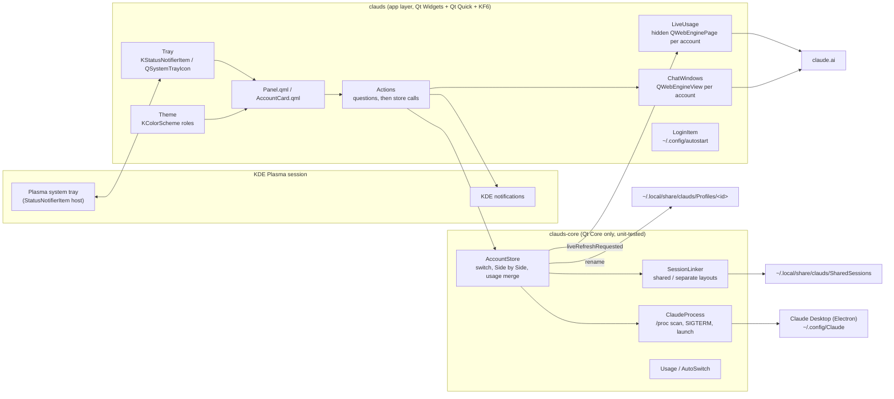
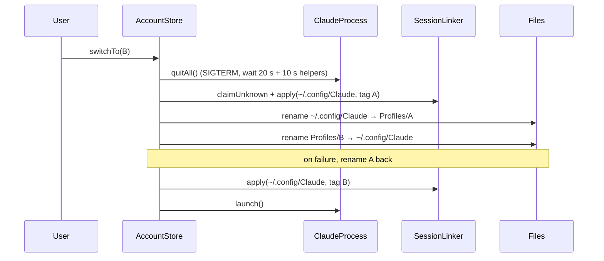

# Clauds for KDE Plasma: port design

Status: first working build, not yet tested against a real Claude Desktop on Kubuntu.
Scope: the `kde/` folder of the `LemcheNET/clauds-kde` repository. The original macOS Swift app is not part of this repository.

## 1. Decision

**Port Clauds as a native C++ / Qt 6 / KDE Frameworks 6 application, with a Qt-Core-only core
library that holds all file and process logic.** The tray item uses `KStatusNotifierItem`, the
panel is Qt Quick, and live usage and chat windows use Qt WebEngine with one persistent profile
per account.

## 2. Situation, complication, resolution

| | |
| --- | --- |
| **Situation** | Clauds is a macOS menu bar app (Swift, AppKit, SwiftUI, WebKit, Sparkle). It keeps one Claude Desktop data folder per account and swaps them by renaming, or starts one Claude copy per account with `--user-data-dir`. |
| **Complication** | Anthropic shipped Claude Desktop for Linux (beta, 2026-06-30, `.deb` package `claude-desktop`, Electron, data in `~/.config/Claude`). Every platform API that Clauds uses (bundle ids, `NSRunningApplication`, `NSWorkspace`, `WKWebsiteDataStore`, `SMAppService`, Sparkle, Finder trash) has no Linux equivalent with the same shape. Swift UI code cannot be reused. |
| **Resolution** | Keep the *behavior* and the *data safety rules* identical, and replace each platform API with its freedesktop / KDE counterpart. Split the code so the risky part (moving session files) is platform-neutral and unit-tested. |

## 3. Alternatives considered

| Option | Pros | Cons | Verdict |
| --- | --- | --- | --- |
| **C++ Qt 6 + KF6** (chosen) | Native Plasma tray (SNI), KDE notifications, `KColorScheme` colors, plain `.deb`, no runtime besides Qt/KF6. Swift structure maps 1:1 to C++ classes. | Most code to write. KF6 not in the cloud dev container, so the KF6 path is built in CI (Ubuntu 26.04 container) only. | **Chosen** by Valdemar, 2026-11-16 |
| Python + PySide6 | Fastest to write, easy to read. Plasma tray and system theme work through the distro PySide6. | No KF6 bindings for StatusNotifierItem/Notifications/ColorScheme, so notifications and scheme colors need workarounds. Python runtime dependency. | Rejected |
| Plasma 6 widget (plasmoid) + backend | Looks most like part of the panel. | A plasmoid cannot safely rename folders or host per-account web logins, so it needs a separate backend service. Two components to build and keep in sync. | Rejected for now; possible later as a front end to the same core |

### Consequences (ADR)

- **Easier:** testing the session logic (`ctest`, 5 suites, runs in seconds); following the user's
  color scheme (Quantum Light / Dark) without hard-coded colors; packaging as a `.deb`; adding a
  Plasma widget later on top of the same core.
- **Harder:** contributors need a C++/Qt toolchain; merging upstream Swift changes is a manual port
  (the folder layout and names mirror upstream to keep that cheap); Wayland does not let an app place
  its own popup next to the tray icon, so the panel is placed by KWin.

## 4. Architecture

### Restart-mode switch (unchanged from upstream)

## 5. Platform mapping

| Concern | macOS (upstream) | KDE Plasma (this port) |
| --- | --- | --- |
| Claude data folder | `~/Library/Application Support/Claude` | `~/.config/Claude` (Electron `userData`), override `CLAUDS_CLAUDE_DATA_DIR` |
| Clauds data folder | `~/Library/Application Support/Clauds` | `~/.local/share/clauds`, override `CLAUDS_DATA_DIR` |
| Find Claude | bundle id `com.anthropic.claudefordesktop` | `/proc/*/exe` inside the Claude install folder; launcher `claude-desktop` (or `claude-desktop-unofficial`) on `PATH`. In the Flatpak the same checks run on the host through `flatpak-spawn --host`; overrides `CLAUDS_CLAUDE_LAUNCHER`, `CLAUDS_CLAUDE_INSTALL_DIRS` |
| Main vs. helper process | `NSRunningApplication` vs. `pgrep Claude.app/Contents/` | Electron argument: helpers have `--type=…` |
| Which copy is which account | `ps -o command=` contains `--user-data-dir=` | `/proc/<pid>/cmdline` `--user-data-dir=` |
| App launched / quit events | `NSWorkspace` notifications | poll `/proc` every 3 s |
| Quit Claude | `NSRunningApplication.terminate()` | `SIGTERM` to main processes (Electron quits cleanly) |
| Start a copy / bring to front | `NSWorkspace.openApplication`, `activate()` | `claude-desktop [--user-data-dir=…]`; a second start with the same data folder hands over to the open copy (Electron single-instance lock) |
| Per-account web login | `WKWebsiteDataStore(forIdentifier:)` | `QWebEngineProfile("account-<id>")`, persistent cookies |
| Embedded-browser sign-in blocks | Safari user agent | Chromium user agent without the `QtWebEngine/x` token |
| Menu bar panel | `NSStatusItem` + borderless `NSWindow` | `KStatusNotifierItem` + frameless `QQuickView`; right-click quick menu lists accounts |
| Colors | `NSColor` system colors | `SystemPalette` + `KColorScheme` positive / neutral / negative; avatar hues derived from the scheme's highlight |
| Dialogs | `NSAlert` | `QMessageBox` / `QInputDialog` (themed by Plasma) |
| Trash | `FileManager.trashItem` | `QFile::moveToTrash` (freedesktop Trash, shows in Dolphin) |
| Start at Login | `SMAppService.mainApp` | `~/.config/autostart/io.github.multiclauds.clauds-kde.desktop` |
| Notifications | in-panel note | in-panel note + `KNotification` (`clauds.notifyrc`) |
| Single instance | bundle id check | `QLocalServer` socket `clauds-<uid>`; `clauds --show-panel` opens the panel |
| Self-update | Sparkle (EdDSA) | none: distribution through a `.deb` (`cpack -G DEB`), updates through apt or a new `.deb` |
| Test hooks | `--link-sessions`, `--unlink-sessions`, `--render-panel` | same names |

## 6. Data safety

The eight rules in [docs/HOW-IT-WORKS.md](../../docs/HOW-IT-WORKS.md#data-safety-rules) are kept
unchanged and covered by `tests/SessionLinkerTest.cpp`:

| Rule | Test |
| --- | --- |
| One live file per session | `roundTripKeepsEachAccountsOwnSessions` |
| Nothing is deleted; newer wins, older to `_conflicts` | `conflictKeepsNewerAndParksOlder`, `exactCopyIsNotKeptTwice` |
| Folder removed only when empty | enforced by `removeIfEmpty` (throws) |
| Unreadable `owners.json` stops everything | `unreadableOwnersStopsEverything` |
| One operation at a time | process-wide recursive mutex + single instance socket |
| Foreign symlinks untouched | `foreignSymlinkIsNotTouched` |
| Private files | `umask 077`, `0700` folders, `0600` files; checked in `linkMovesFilesAndRecordsOwners`, `ownersBackupIsKept` |

Linux-specific addition: a folder rename that would cross disks (`EXDEV`) is refused with a clear
message, instead of silently copying gigabytes. `~/.config` and `~/.local/share` must be on the same
file system (the default).

## 7. Risks and open questions

| # | Risk / question | Impact | Mitigation / next step |
| --- | --- | --- | --- |
| R1 | The official package's install folder is not documented. Process detection depends on it. | Clauds cannot see or quit Claude; a switch would fail with "Claude did not quit" only if Claude is running unseen. | Defaults cover `/usr/lib/claude-desktop`, `/opt/Claude`, the launcher's real folder; env overrides. **Verify on Kubuntu:** `ps -eo pid,args \| grep -i claude` and `readlink -f $(which claude-desktop)`. |
| R2 | Claude Desktop for Linux is a beta. It may not honor `--user-data-dir`, or may store Code sessions differently from macOS. | Side by Side or session sharing could misbehave. | Test with a backup first (see README). Restart mode (rename) does not depend on `--user-data-dir`. |
| R3 | Code sessions on Linux beta: reported persistence bugs on arm64. | Session sharing may have nothing to share. | Out of scope; Clauds only moves files that exist. |
| R4 | Wayland: an app cannot place its own popup next to the tray icon. | Panel appears where KWin places it. | Right-click quick menu for one-click switching. A Plasma widget front end is the long-term fix. |
| R5 | Live usage uses claude.ai's private endpoint (same as upstream). | Numbers stop if Anthropic changes it. | Falls back to the local `plan-usage-history.json`. |
| R6 | Cloudflare or Google may challenge the embedded browser. | Sign-in for live usage fails. | User agent without the QtWebEngine token; pop-ups open in the same profile. |

## 8. What is not ported yet

- Translations (strings are English, as upstream). Next step: `KLocalizedString` / `ki18n`.
- `--render-demo` (README pictures and GIF). `--render-panel` exists.
- Migration from the old "Claude Switcher" name (macOS only, not needed).
- A Plasma widget front end (see R4).
